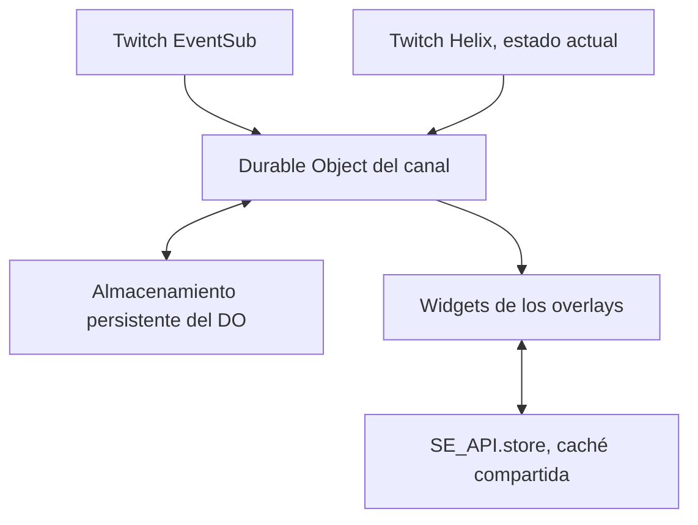

# Fase 2: predicciones de Twitch y contrato para la versión robusta

Investigación realizada el 30 de octubre de 2026. Esta entrega define el funcionamiento y las decisiones para la fase 3; no despliega un Worker ni crea todavía el widget nuevo.

## Conclusión

La representación debe poder reconstruirse desde un estado completo recibido en cualquier momento. El estado real se obtiene de Twitch; el Durable Object del puente lo conserva y distribuye; SE_API.store sirve como caché compartida. Las animaciones representan ese estado y tienen fechas de caducidad independientes de la conexión.

Se recomienda conservar la arquitectura de un puente por canal que ya aparece en el Worker adjunto, incorporando reconciliación Helix y persistencia del estado. El cambio a webhooks es una alternativa de infraestructura, no una condición para reparar el widget.

## 1. Lo que significan los estados

La ventana de apuestas y la resolución son momentos distintos. Al cerrarse la ventana, la predicción sigue pendiente. La resolución reparte los puntos; la cancelación los devuelve. Una predicción sin resolver impide crear la siguiente. Twitch documenta la cancelación automática tras 24 horas desde el cierre si no se resuelve. [T1]

| Estado Helix | Significado | Evento que normalmente lo comunica |
|---|---|---|
| ACTIVE | Acepta apuestas durante su ventana | begin y progress |
| LOCKED | Apuestas cerradas, resultado pendiente | lock |
| RESOLVED | Ganador fijado | end con status resolved |
| CANCELED | Cancelada | end con status canceled |

ACTIVE puede pasar directamente a RESOLVED o CANCELED. Haber recibido lock no puede ser requisito del renderer. `active_expired`, `locked_waiting_resolution`, `stale`, STOP y el tiempo visible del resultado son conceptos internos del laboratorio/widget, no estados adicionales de Helix. [T2]

Los límites de creación son 2-10 opciones, 45 caracteres de título, 25 por opción y una ventana de 30-1800 segundos. Con dos opciones los colores son azul/rosa; con más, todas son azules. [T1, T2]

## 2. Endpoints, permiso y titular de la autorización

| Operación | Petición | Permiso |
|---|---|---|
| Consultar | GET https://api.twitch.tv/helix/predictions | channel:read:predictions, o manage |
| Crear | POST a la misma URL, cuerpo JSON | channel:manage:predictions |
| Bloquear/resolver/cancelar | PATCH a la misma URL, cuerpo JSON | channel:manage:predictions |

Las peticiones usan Client-Id y Authorization: Bearer. El GET recibe `broadcaster_id` y opcionalmente `id`; `first` permite 1-25 elementos. La referencia define el cuerpo JSON de POST/PATCH. Algunos ejemplos antiguos de la guía mezclan parámetros de consulta para PATCH; la implementación seguirá la referencia del endpoint. [T2]

Para el widget de lectura basta el permiso ya solicitado por el adjunto: `channel:read:predictions`. El token de usuario debe pertenecer al broadcaster consultado, aquí 133649243. Un token de un moderador no sustituye esa condición, aunque ese moderador pueda gestionar predicciones desde la interfaz de Twitch. OAuth, access token y refresh token permanecen en el servidor. [T2]

La aplicación debe validar el token al arrancar y cada hora, comprobar su usuario, Client ID y scopes, y serializar los refresh para evitar carreras. En un 401 se permite un refresh y reintento controlado; un fallo de red/5xx no debe borrar por sí solo un refresh token. Una autorización definitivamente inválida requiere volver a autorizar. [T6, T7]

## 3. Qué se recupera con Helix

La consulta inicial propuesta es:

`GET /helix/predictions?broadcaster_id=133649243&first=1`

La lista viene ordenada de más reciente a más antigua. Un resultado puede ser ACTIVE, LOCKED o una predicción ya terminada. La guía permite consultar los últimos 90 días: la primera fila no significa que haya una predicción todavía visible. Para consultar una predicción concreta se añade su `id`. [T1, T2]

Reglas del diseño:

- Una respuesta correcta con la lista más reciente vacía puede establecer ausencia de predicciones conocidas. Una consulta filtrada por ID vacía no demuestra que el canal esté vacío.
- 401, 429, timeout y 5xx representan desconocimiento o degradación, nunca una cancelación ni un estado idle confirmado.
- Un resultado terminado hace minutos u horas no vuelve a mostrarse por ser la primera fila.
- Una respuesta HTTP iniciada antes de un evento nuevo no puede sobrescribirlo al terminar después.
- Si la respuesta contradice una predicción reciente conocida, se repite la reconciliación; no se interpreta una contradicción como autorización para retroceder el estado.

## 4. Traducción entre los dos formatos de Twitch

| Dato | Helix | EventSub | Normalización propuesta |
|---|---|---|---|
| Canal | broadcaster_id | broadcaster_user_id | broadcaster_id |
| Inicio | created_at | started_at | created_at |
| Cierre previsto | created_at + prediction_window | locks_at en begin/progress | locks_at |
| Cierre efectivo | locked_at cuando esté disponible | locked_at en lock | locked_at o null |
| Final | ended_at | ended_at en end | ended_at o null |
| Estado | Mayúsculas | Tipo de evento y status de end | active/locked/resolved/canceled |
| Color | BLUE/PINK | blue/pink | blue/pink |
| Sin top predictors | Puede ser null | Lista cuando corresponda | [] |

Begin no incluye contadores ni top_predictors. Progress, lock y end aportan datos distintos: no se puede asumir que todos los eventos incluyen todas las fechas. `channel_points_won` es null en progress/lock y 0 para perdedores o cancelación; el valor del ganador lo comunica Twitch. Una cancelación no tiene ganador. [T3]

Si un campo de votos no llega, se conservan los valores ya conocidos del mismo ID. Si no se conocen, se trata como dato pendiente y se consulta Helix, en vez de afirmar que vale cero o reutilizar cifras de otra predicción. El ejemplo de protocolo contiene datos completos confirmados; no representa un begin sin sincronizar.

La referencia de Helix permite `locked_at` nulo fuera de LOCKED, aunque algún ejemplo de la guía conserva esa fecha después. El diseño acepta ambos casos: no exige locked_at para representar un resultado. Se conserva una fecha conocida del mismo ID, pero no se inventa una a partir del momento de recarga. [T1, T2]

Los contadores son valores acumulados, no incrementos para sumar. Los porcentajes del widget actual se calculan por puntos, mientras `users` expresa participantes por opción. La lista de top_predictors no es el censo completo y no debe usarse para reconstruir esos totales. Los multiplicadores mostrados serán orientativos; los premios finales proceden de Twitch. [T3]

## 5. EventSub no es un historial recuperable

Twitch entrega notificaciones al menos una vez y puede repetir un message_id. Hay que deduplicar. El WebSocket nativo entrega metadata y payload; el JSON `{type, subscription, event}` actual es una transformación del puente de Los Broles. Deben conservarse message_id y message_timestamp al normalizar. [T4, T5]

Hay dos reconexiones diferentes:

| Caso | Tratamiento documentado |
|---|---|
| session_reconnect de Twitch | Abrir la URL recibida, mantener el socket antiguo hasta el welcome del nuevo; las suscripciones se transfieren |
| Pérdida de conexión | Crear una sesión nueva, volver a suscribirse y consultar Helix para recuperar estado |

Twitch no reenvía lo perdido durante un corte. Los mensajes keepalive y notification alimentan el watchdog. Una revocation cambia la salud del puente; no resuelve la predicción. El protocolo nativo solo acepta pong como tráfico del cliente; los mensajes propios de sincronización se envían al puente de Los Broles, no a Twitch. [T4]

## 6. Revisión concreta del código disponible

Se ha revisado `workers.js` adjunto, 267 líneas, SHA-256:

`52367060b862b3f9a30143b9e0b725dd6db2b679f0f6ddb278609231e121c665`

El adjunto no incluye wrangler ni acredita qué versión está desplegada. Las observaciones siguientes corresponden a ese archivo, no a una inspección de Cloudflare en producción.

| Punto del adjunto | Comportamiento observado | Reparación necesaria en fase 3 |
|---|---|---|
| /ws, líneas 59-66 | Enruta a PREDICTION_BRIDGE por canal | Conservar un coordinador por canal y limitarlo al canal configurado |
| Constructor y fetch, 117-145 | Clientes en memoria, welcome al conectar | Persistir estado y revisión, y enviar snapshot completo al incorporar cada cliente |
| ensureTwitchConnected, 148-172 | Una conexión upstream; sin GET de predicciones | Reconciliar con Helix al iniciar o recuperar sesión |
| session_reconnect, 184-206 | Cierra el socket antiguo antes de abrir el nuevo | Migración sin corte y callbacks ligados a la identidad del socket |
| notification, 208-214 | Reenvía el evento; pierde metadata y no lo persiste | Deduplicar, validar, normalizar, persistir y después emitir estado |
| createPredictionSubscriptions, 216-245 | subscribed=true incluso con fallos parciales | Confirmar cada una de las cuatro suscripciones y reintentar solo las pendientes |
| onTwitchClose, 247-252 | Reconexión fija sin distinguir socket viejo/nuevo | Una sola recuperación, backoff acotado y resync |
| ensureUserToken, 88-113 | Se guía por caducidad; cualquier refresh fallido borra token | Validación periódica y distinguir fallo transitorio de autorización inválida |

El mensaje welcome enviado por el widget no autentica la conexión: el servidor adjunto ignora los mensajes de sus clientes. Ese session_id tampoco es la sesión de EventSub de Twitch.

En `predicciones.js` adjunto, líneas 308-411, el resultado programa la limpieza y el cierre del socket llama a cancelAllPendingActions. Esta cancela temporizadores y elimina clases sin reconstruir el estado visual. Es compatible con la reproducción de trofeos atascados del laboratorio; no prueba por sí solo qué provocó el corte en una sesión concreta de OBS.

## 7. Arquitectura recomendada para la fase 3

Estas son decisiones del proyecto, no contratos que impongan Twitch o StreamElements.

El mismo DO ya presente en el código concentra el upstream y las consultas de todos los overlays. Su almacenamiento privado conserva estado, revisión, época de protocolo y deduplicación acotada. Las propiedades JavaScript del constructor no sustituyen almacenamiento persistente. Workers KV tiene consistencia eventual; no se elegirá como coordinador de actualizaciones rápidas ni del orden entre revisiones. [C1, C2]

La política inicial será: consultar al arrancar, al recuperarse de un corte y cuando una instancia solicite estado no verificado recientemente; compartir peticiones simultáneas; mientras haya predicción pendiente y clientes, reconciliar también de forma periódica. Como valores de partida se proponen 30 segundos entre comprobaciones y 5 segundos de reutilización de una consulta reciente con upstream sano. Son parámetros de diseño que se medirán, no límites oficiales.

Los 429 respetan Ratelimit-Reset; los reintentos por error usan backoff y jitter. No se fija como contrato una cuota numérica de Helix tomada de un ejemplo; se leen las cabeceras reales. [T8]

Al quedarse sin clientes, el upstream puede cerrarse tras una gracia propuesta de 30 segundos. Al volver el primer cliente se restaura almacenamiento y se verifica con Helix. Esto evita depender de que OBS permanezca abierto para conservar coherencia, sin exigir un socket activo las 24 horas.

### Evitar que GET sobrescriba un evento más nuevo

1. Establecer las suscripciones y empezar a aceptar notificaciones.
2. Al lanzar GET, capturar la revisión y el ID actual.
3. Procesar cada notificación mediante el mismo actualizador serializado del canal.
4. Si al llegar GET cambió la revisión/ID, descartar o reconciliar esa respuesta y repetir la consulta agrupada.
5. Persistir la nueva revisión antes de difundirla. Una notificación duplicada no crea otra transición.

No hay una transacción distribuida entre Helix y EventSub: se previenen retrocesos locales y se reconcilian discrepancias, sin prometer una instantánea global perfecta. Para ordenar eventos se preserva la precisión de su timestamp RFC3339 y se aplican también las reglas de estado e ID. La hora de recepción sola no establece el orden de Twitch.

## 8. Estado completo y versión del protocolo

Se propone un protocolo separado llamado `bridge.state`, versión 2. El ejemplo de [prediction-state-v2.example.json](prediction-state-v2.example.json) es una especificación, no una ruta que ya ofrezca el Worker actual.

| Campo propuesto | Responsabilidad |
|---|---|
| protocol_version | Evitar interpretar estado de un protocolo incompatible |
| broadcaster_id | Aislar el canal |
| epoch + revision | Identificar la generación persistente y el orden del estado |
| server_now | Referencia temporal para sincronizar el reloj visual |
| sync | Separar estado confirmado, sincronizando, degradado y autorización requerida |
| prediction | Objeto completo, o null para ausencia confirmada |
| presentation | Fechas absolutas de ocultado y versión de la política visual |

`epoch` se genera una vez y se persiste; no cambia al reiniciar OBS ni al reconstruir el DO. `revision` crece en cada commit de estado del servidor. Un heartbeat puede repetir revisión con nueva hora. Las notificaciones descartadas no la incrementan. Un cambio deliberado de época invalida la caché anterior; no se comparan UUID como si fueran números ordenados.

Cada incorporación o petición `bridge.sync` recibe estado completo. Mientras falta confirmación puede llegar `syncing`; un error no se convierte en `prediction: null` con estado ready. Los mensajes nuevos convivirán con el formato legado durante la transición, o usarán una ruta versionada para evitar que dos widgets interpreten el mismo mensaje como dos transiciones.

Reglas obligatorias del actualizador:

- Reconstruir desde snapshot, progress, lock o end sin requerir haber visto begin.
- Un ID anterior no sustituye una predicción posterior. Comprobar inicio, versión y procedencia.
- El mismo resultado no vuelve a empezar por duplicación, replay o evento de almacenamiento.
- Un progress anterior no reabre una predicción terminada ni suma de nuevo sus votos.
- Fechas o ganadores incoherentes generan diagnóstico y reconciliación; no se fabrica un ganador.
- Null en un snapshot confirmado limpia un estado anterior; un fallo de red no lo limpia como si se hubiera confirmado ausencia.

## 9. Papel exacto de SE_API.store

La API documenta persistencia compartida por cuenta, sobrescritura del objeto completo, get asíncrono y notificaciones kvstore:update para los widgets. No documenta CAS, transacciones entre widgets ni un acuse Promise para set. Sus claves no se eliminan. [S1]

Se usará una sola clave alfanumérica propuesta: `brolesPredictions133649243v2`. Se guardará un sobre con schemaVersion, epoch, revision y el snapshot recibido del puente. No se guardarán tokens, temporizadores, nodos DOM ni clases de animación.

Al cargar, el widget puede leer la caché mientras conecta, pero la confirma con el puente antes de mostrar un estado no verificado. Si el resultado de ese get llega después de una revisión viva más reciente, se ignora. Durante una conexión confirmada, un evento KV antiguo tampoco hace retroceder la pantalla.

Dos overlays pueden escribir en orden inverso la misma clave. Un read-before-write no ofrece exclusión mutua. La corrección se basa en la revisión del servidor y la confirmación al conectar, no en presumir que la última escritura de SE sea la mejor. Se agrupan escrituras de progress y se priorizan las transiciones; no se escribe un contador cada frame ni al recibir el eco KV.

Al confirmar ausencia se guarda un tombstone versionado con prediction=null. La clave no se borra y no se crea una nueva por cada predicción. Un resultado caducado en la caché nunca reabre la animación.

## 10. Regla que impide revivir los trofeos

La duración visual es una decisión del widget. Como política de partida se mantienen 15 segundos para el aviso de cierre y 10 segundos para el resultado, medidos desde locked_at y ended_at, respectivamente. Esos tiempos no los impone Twitch.

| Momento de incorporación del overlay | Representación exigida |
|---|---|
| Active antes de locks_at | Reconstruye opciones, votos y tiempo restante |
| Ventana vencida sin lock confirmado | Cuenta a cero; fase local pendiente, resync; no inventa una resolución |
| Lock hace 5 segundos | Como máximo quedan 10 segundos de aviso |
| Lock hace 2 minutos | Estado pendiente conservado, aviso oculto |
| Resolved hace 4 segundos | Como máximo quedan 6 segundos del resultado |
| Resolved hace 2 minutos | Título, trofeos y barras permanecen ocultos |
| Canceled | Presentación de cancelación, sin ganador ni trofeo de victoria |

El aviso de una ventana vencida sin confirmación tampoco permanece indefinidamente: puede caducar respecto a locks_at sin cambiar el estado remoto. Un resultado no depende de esa fase previa ni de clones de barras creados durante lock.

El reloj del widget usa las fechas del servidor y una estimación de desfase mediante petición/respuesta; el error está limitado por la latencia y su asimetría, no desaparece mágicamente. Se conserva el origen temporal y se apoya la espera local en un reloj monotónico. Recibir otra copia no añade diez segundos desde Date.now().

La pantalla se recalcula al recibir estado, al reconectar, al volver a ser visible y al vencer cada plazo. Si se ha excedido el plazo, se fuerza el estado final oculto, aunque animationend no llegue. Desconectar el transporte no elimina el estado ni convierte la limpieza visual en una tarea cancelada para siempre. Todos los callbacks comprueban ID/revisión/generación antes de tocar el DOM. El texto de Twitch se inserta como texto, no mediante innerHTML.

## 11. Viabilidad gratuita y configuración pendiente

Cloudflare ofrece DO en el plan Free con backend SQLite. Publica 100.000 solicitudes/día y 13.000 GB-s/día de duración; son cuotas finitas, compartidas con el uso correspondiente de la cuenta. Para un DO activo permanentemente, 128 MB × 86.400 segundos son aproximadamente 10.800 GB-s/día de duración, sin sumar otras dimensiones o instancias. Es una estimación de arquitectura, no una medición de la cuenta de Los Broles. [C3]

Los WebSockets salientes no hibernan. Cambiar solo accept por acceptWebSocket en los clientes no permite hibernar mientras el upstream de Twitch siga manteniendo el objeto activo. Mantener un coordinador por canal, evitar consultas por cada overlay y cerrar conexiones innecesarias ayuda a controlar el consumo. Webhooks más clientes hibernables serían una alternativa si las métricas justifican ese cambio. [C4]

Antes del despliegue de fase 3 hay que comprobar el wrangler y el backend del namespace ya existente. El adjunto no permite confirmar que sea SQLite ni conocer las cuotas consumidas por otros servicios. No se puede prometer un número ilimitado de widgets gratuitos; sí diseñar un solo upstream para el canal y medir la carga real de los overlays de Los Broles.

## 12. Entrega exigida a la fase 3

| Área | Criterio de aceptación |
|---|---|
| Arranque | Ningún overlay necesita haber visto begin para representar estado completo |
| Pérdida de datos | Corte, recuperación y GET tardío no producen retrocesos ni resultados nuevos falsos |
| Duplicados | Repetir un message_id no repite votos ni la animación final |
| Orden | End de P1 no puede ocultar ni sustituir P2 |
| Almacenamiento | Lectura KV tardía y escrituras A/B invertidas no ganan a la revisión confirmada |
| OBS | Ocultar, recargar o cambiar de overlay durante end no deja trofeos colgados |
| Datos extremos | 0 votos, 10 opciones, nulls y cancelación no generan NaN, Infinity ni ganador ficticio |
| Transporte | Keepalive, revocation y reconexiones antigua/nueva se distinguen y recuperan |
| Servidor | Estado, revisión y deduplicación sobreviven al reinicio del DO |
| Despliegue | Versión nueva junto al legado, rollback preparado, secretos solo en servidor |

La investigación queda cerrada. La fase 3 implementará estas decisiones, incorporará snapshots/Helix al mock y probará la misma matriz con el widget nuevo. El widget de referencia y el Worker adjunto no han sido editados en esta fase.

## Fuentes oficiales consultadas

- [T1, guía de predicciones](https://dev.twitch.tv/docs/api/predictions/).
- [T2, referencia de endpoints y formatos Helix](https://dev.twitch.tv/docs/api/reference/#get-predictions).
- [T3, formatos de eventos y Top Predictors](https://dev.twitch.tv/docs/eventsub/eventsub-reference/).
- [T4, conexión y reconexión WebSocket](https://dev.twitch.tv/docs/eventsub/handling-websocket-events/).
- [T5, duplicados EventSub](https://dev.twitch.tv/docs/eventsub/#handling-duplicate-events).
- [T6, validación de tokens](https://dev.twitch.tv/docs/authentication/validate-tokens/).
- [T7, refresh de tokens](https://dev.twitch.tv/docs/authentication/refresh-tokens/).
- [T8, límites y cabeceras Helix](https://dev.twitch.tv/docs/api/guide/#twitch-rate-limits).
- [S1, SE_API.store](https://docs.streamelements.com/overlays/custom-widget).
- [C1, almacenamiento Durable Objects](https://developers.cloudflare.com/durable-objects/best-practices/access-durable-objects-storage/).
- [C2, consistencia Workers KV](https://developers.cloudflare.com/kv/concepts/how-kv-works/).
- [C3, cuotas DO](https://developers.cloudflare.com/durable-objects/platform/pricing/).
- [C4, WebSockets y hibernación](https://developers.cloudflare.com/durable-objects/best-practices/websockets/).
